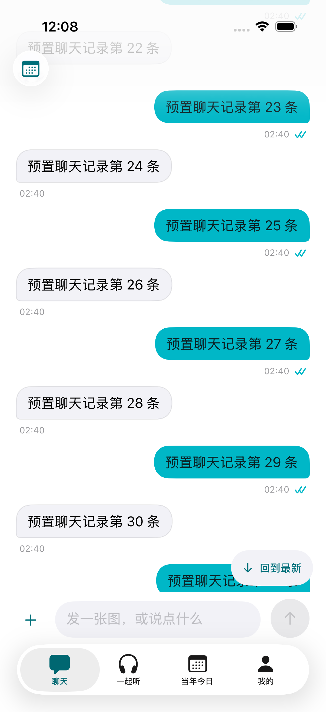
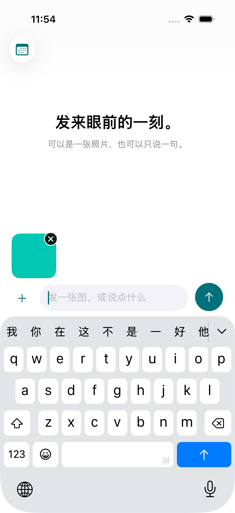
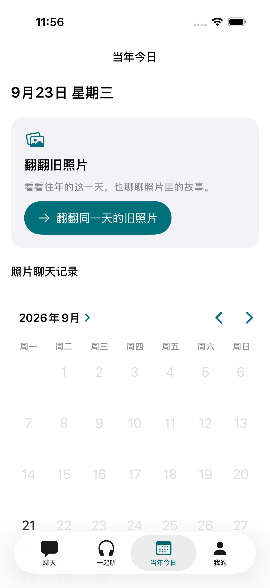
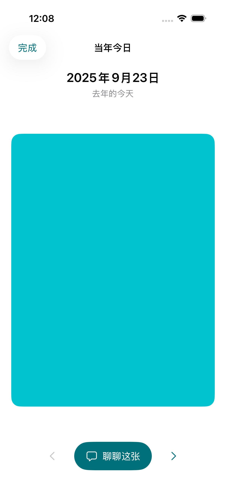
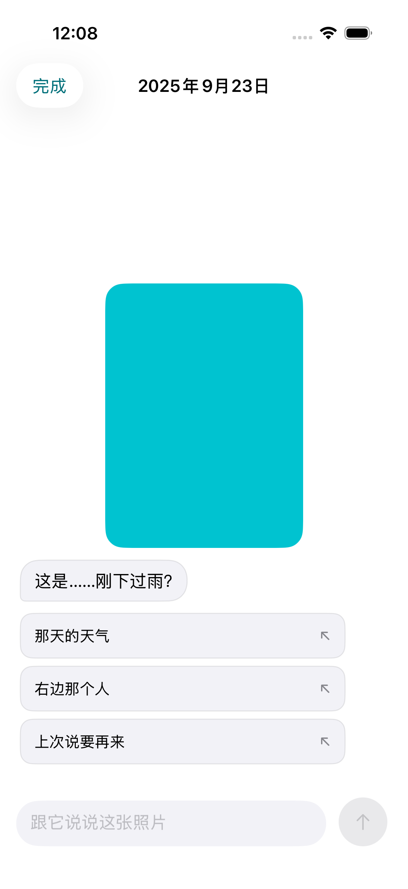
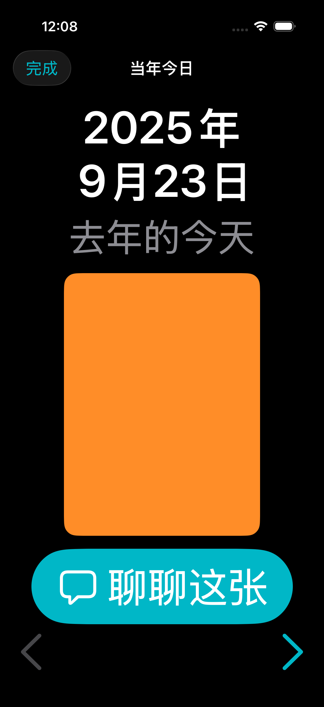
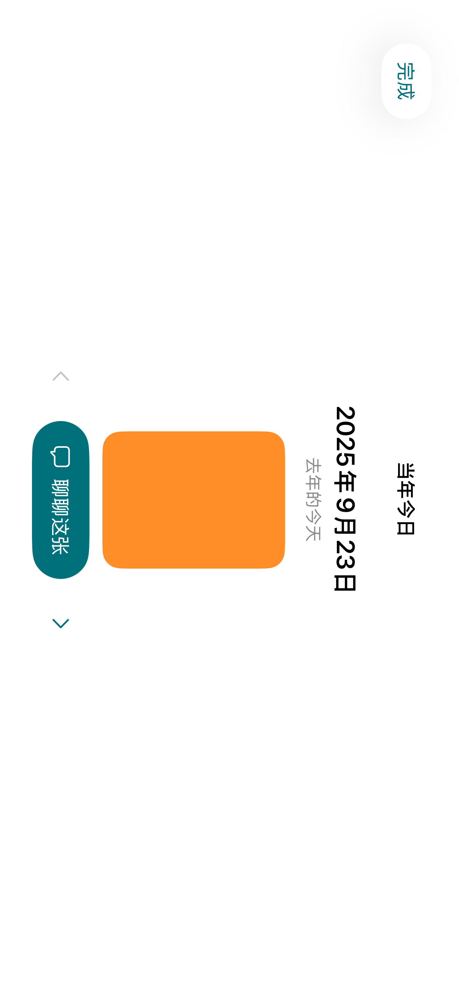
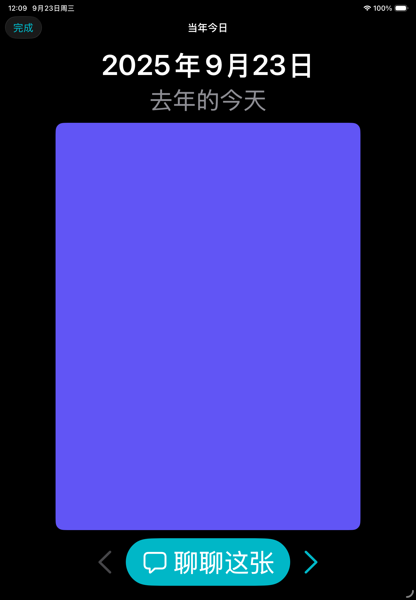
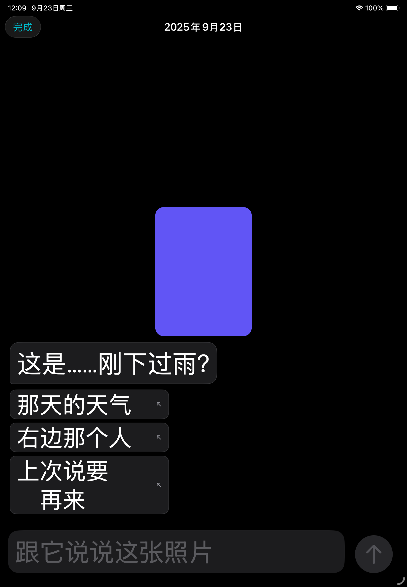
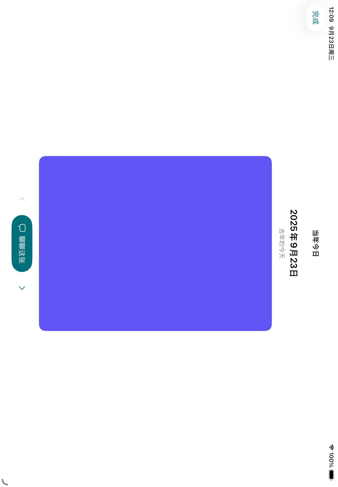

# 聊天与当年今日界面重构验收

> 状态：本地实现与模拟器验收完成｜适用：iOS 客户端｜核验：2026-09-23｜依据：当前未提交工作区与本轮 Xcode 测试；不代表生产验收

## 行为变化

- 聊天移除标题和外层裁切，保留日历／每日回顾入口；消息在系统导航区域下连续滚动。
- 普通聊天、照片房间、存档续聊共用输入组件，业务模型与数据位置保持独立。附件进入底部安全区，不再依赖列表内固定照片占位。
- 回到最新仅经日期导航状态触发滚动，按钮位于附件及发送栏之上。
- 当年今日首页先显示日期与浏览入口，再显示存档日历。照片左右翻页，可返回上一张，点击“聊聊这张”才创建房间。
- 日期、来源与可发送图片保持对应；加载失败可重试，过期图片结果不可替换当前选择。界面缓存最多保留相邻三张已加载图片。
- 照片浏览与房间共享导航容器和关闭按钮，内容短淡入；最大辅助字号明确传递至全屏页面。
- 删除无调用的 MurmurDisc、MurmurFloatingDisc、MurmurNotice，以及多余按钮样式包装、旧上下滑手势和重复输入栏布局。

## 检查与边界

| 检查 | 结果 |
| --- | --- |
| Murmur scheme 构建（build-for-testing） | 通过 |
| MurmurTests | 215 项通过，包含新增分页缓存、异步乱序及失败重试测试 |
| iPhone 相关 UI 回归 | 32 个不同用例的最终结果通过，包含失败修正后的定向重跑 |
| iPad 相关 UI 回归 | 4 个不同用例的最终结果通过 |
| 最后一次操作栏布局修正 | iPhone 3 项、iPad 1 项定向回归最终通过 |
| 仓库检查与 diff 空白检查 | 通过 |
| 实际截图检查 | iPhone／iPad、竖屏／横屏、浅色／深色、最大辅助字号及减少动态效果配置 |

所有 UI 用例使用 fake API 与临时存储，截图里的消息和色块照片均为测试数据。上述数量按用例去重，不代表全量 UI 套件或正式 CI 一次性通过。单元测试在最后一次照片操作栏布局微调前通过；微调后重新构建并运行受影响的界面用例。

本轮发现并修复全屏页面未继承测试大字号，以及照片操作按钮在大字号／横屏下超出可视区域的问题。测试同时修正 44 点尺寸的浮点精度误判与 iPad 原生标签重复无障碍节点查询。最后一轮关闭照片浏览用例曾在应用启动后找不到首页标签，未进入照片流程；相同二进制单独重跑通过，保留这一启动时序波动记录。

本地证据：`/private/tmp/murmur-native-actions-build.log`、`/private/tmp/murmur-native-final-phone-1150.xcresult`、`/private/tmp/murmur-native-verified-phone-1204.xcresult`、`/private/tmp/murmur-native-verified-ipad-voice-1159.xcresult`、`/private/tmp/murmur-native-actions-phone-1208.xcresult`、`/private/tmp/murmur-native-actions-ipad-1208.xcresult`、`/private/tmp/murmur-native-close-final.xcresult`。

只检查本机 iOS 26.5 模拟器；iOS 18 实机、真实相册与 iCloud 下载、真机中文输入法、正式 CI 和生产环境不在本轮验收证据内。最低部署版本仍为 iOS 18。额外的小屏 SE 模拟器因首次数据迁移停滞而中止，未计入覆盖；VoiceOver 已检查标签及点击区域，未进行真人听读验收。没有生产部署、分发打包或真机安装，已有未提交工作保留。

## 界面截图

### 聊天顶部与键盘

### 当年今日与照片房间

### iPhone 最大辅助字号与横屏

### iPad 最大辅助字号与横屏

